# Getting Started

This walks through installing Simposter, the first-launch setup wizard, generating your first poster, and a reference for every Settings tab. For a tour of every page, see the [User Guide](USER_GUIDE.md). For connecting Plex, Jellyfin and/or Emby and linking their libraries, see [MEDIA_SERVERS.md](MEDIA_SERVERS.md). For webhook setup (Radarr/Sonarr/Tautulli), see [WEBHOOKS.md](WEBHOOKS.md). For templates, logos and Collections, see [COLLECTIONS_AND_POSTERS.md](COLLECTIONS_AND_POSTERS.md). For overlays (badges, rules, Kometa import, MDBList), see [OVERLAYS.md](OVERLAYS.md).

---

## Install

### Docker Compose (recommended)

Two ways to get the image — pull the pre-built one from GHCR (fastest, no local build), or build it yourself from source. Both use the same `./config` bind mount, so your database, presets, and saved posters live outside the container either way.

**Option A — pull the pre-built image (no clone/build needed):**

```yaml
# docker-compose.yml
services:
  simposter:
    image: ghcr.io/pjgithub9/simposter:latest
    container_name: simposter
    ports:
      - "8003:8003"
    environment:
      - CONFIG_DIR=/config
    volumes:
      - ./config:/config
    restart: unless-stopped
```

```bash
docker-compose up -d
```

Images are built and pushed to [ghcr.io/pjgithub9/simposter](https://github.com/PJGithub9/Simposter/pkgs/container/simposter) automatically, tagged by branch name. `latest` tracks `main`, the stable release. For development builds with the newest features, use `ghcr.io/pjgithub9/simposter:webui-overhaul-dev` instead. The version badge in the top bar shows a dot when a newer version of your branch is out, and a "Move to" link if your branch has been merged into another one.

**Updating (Option A):**
```bash
docker-compose pull
docker-compose up -d
```

**Option B — build from source (what the repo's own `docker-compose.yml` does by default):**

```bash
git clone https://github.com/PJGitHub9/Simposter.git
cd Simposter
docker-compose up -d --build
```

This builds from the included `Dockerfile` instead of pulling an image — useful if you want to run a fork, a local branch, or verify exactly what's running by building it yourself. The shipped `docker-compose.yml` uses `build: .`; swap it for `image: ghcr.io/pjgithub9/simposter:<tag>` (Option A above) if you'd rather not build locally at all.

Open `http://localhost:8003` — the setup wizard takes it from there (see below).

**Updating (Option B):**
```bash
git pull
docker-compose up -d --build
```
`./config` is a bind-mounted folder, not part of the image — pulling or rebuilding never touches your settings, database, or saved posters, in either option.

**File permissions:** if `./config` is owned by a specific user/group on your host (common on Unraid/NAS setups) and the container's default user can't write to it, set `PUID`/`PGID` (and optionally `UMASK`) under `environment:` in `docker-compose.yml` — the container's entrypoint creates a matching user and takes ownership of `/config` before starting, the same convention LinuxServer.io images use:
```yaml
environment:
  - PUID=1000
  - PGID=1000
  - UMASK=0002
```

### Unraid

There's no Community Applications template yet. Add it by hand: **Docker → Add Container**, then:

| Field | Value |
|-------|-------|
| Name | `simposter` |
| Repository | `ghcr.io/pjgithub9/simposter:latest` |
| Network type | `bridge` (or the custom network your Plex/Jellyfin/Radarr containers use) |
| Port | container `8003` → host `8003` |
| Path | container `/config` → host `/mnt/user/appdata/simposter` |
| Variable `PUID` | `99` |
| Variable `PGID` | `100` |
| Variable `TZ` | your timezone, e.g. `America/Toronto` (Unraid usually fills this in) |

Apply, then open `http://<unraid-ip>:8003`. To update, use **Check for Updates** on the Docker tab (or `docker pull` the image). If Radarr/Sonarr run on the same Docker network, they can reach Simposter at `http://simposter:8003`; otherwise use the Unraid IP.

### Alternative: build script + `docker run`

If you'd rather manage the container yourself instead of using Compose:

```bash
# Windows
build-docker.bat

# Linux/Mac
./build-docker.sh

# Then run it
docker run -d \
  --name simposter \
  -p 8003:8003 \
  -v /path/to/config:/config \
  simposter:latest
```

Both scripts accept an optional tag argument (e.g. `build-docker.bat dev`) if you want to label the image something other than `latest`/`local`.

### Local development (no Docker)

Requires Python 3.x and Node.js `^20.19.0` or `>=22.12.0` (see `frontend/package.json`).

The simplest path — one command, one terminal, both servers with hot-reload:

```bash
cd frontend
npm install
npm run dev:full
```

This runs the backend (`uvicorn` on port 8003) and frontend (Vite dev server) concurrently. The backend half reads a `.env` file from the repo root (`../.env` relative to `frontend/`) — copy [`.env.example`](../.env.example) to `.env` first if you want to pre-fill Plex/API keys; if you skip that, `npm run dev:full` still works, you'll just configure everything through the onboarding wizard/Settings UI instead once the app is running.

Prefer two separate terminals (e.g. to see backend/frontend logs independently)?
```bash
# Terminal 1 — backend (from the repo root)
pip install -r requirements.txt
uvicorn backend.main:app --reload --port 8003

# Terminal 2 — frontend
cd frontend
npm install
npm run dev
```

---

## First Launch: Setup Wizard

The first time you open Simposter, a setup wizard walks you through everything. It takes about five minutes. Have these ready:

- your media server's address and credentials: a **Plex token** ([how to find it](https://support.plex.tv/articles/204059436-finding-an-authentication-token-x-plex-token/)) and/or a **Jellyfin/Emby API key** (Dashboard → API Keys)
- a **TMDb API key** (free, [themoviedb.org](https://www.themoviedb.org/settings/api)); a **TVDB key** if you have TV libraries, and optionally a **Fanart.tv key**
- optionally, your Radarr/Sonarr address and API key

Every step can be changed later in **Settings**, and Settings → Advanced → **Run Startup Wizard** opens it again. **Skip setup** on the first page closes it without changing anything.

### 1. Welcome and servers

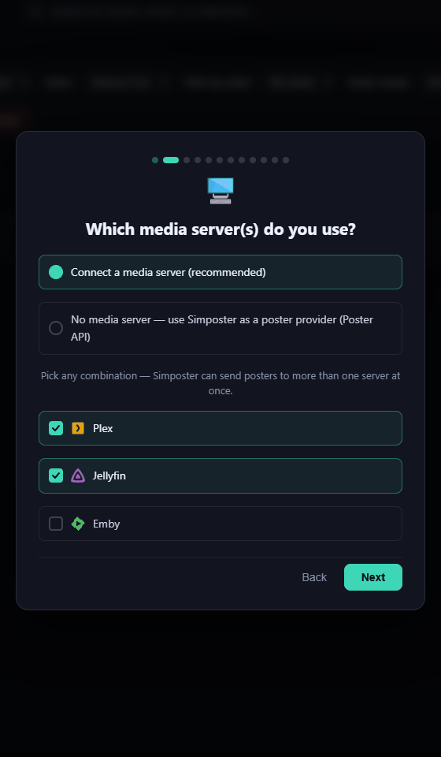

Pick the servers you use: Plex, Jellyfin and/or Emby, in any combination.

Or pick **No media server — use Simposter as a poster provider**. The wizard then only asks for your API keys and default look, sets up the [Poster API](POSTER_API.md), and ends on the Poster API page. Connecting a server is still recommended: without one there are no file-based badges (4K, HDR, audio), no ratings from the server and nothing that keeps posters up to date ([why](POSTER_API.md#why-connect-a-media-server)).

### 2. Connect

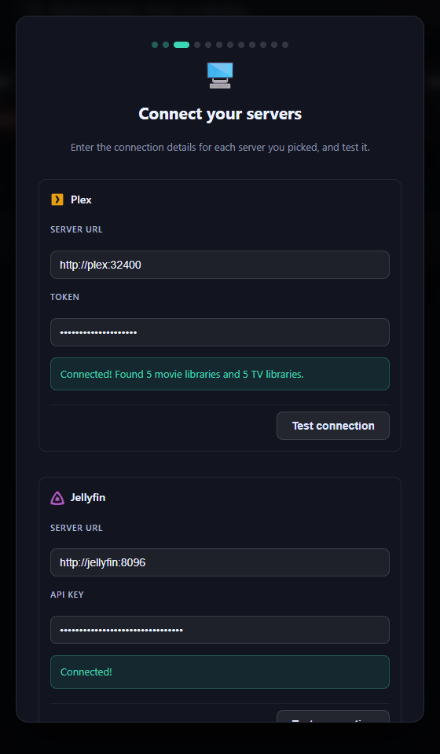

Enter each server's URL and its token or API key, then **Test connection**. Use the address Simposter can reach (in Docker, often the server's LAN IP, not `localhost`). At least one server has to connect.

### 3. Libraries

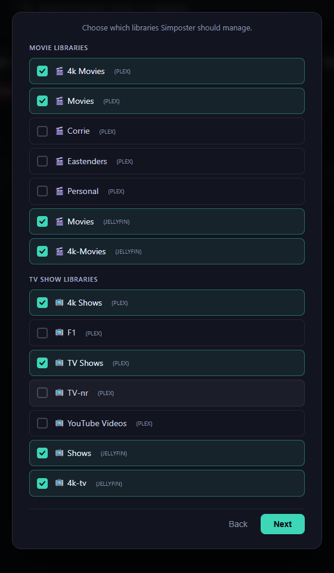

Untick libraries you don't want Simposter to manage (home videos, YouTube, etc.).

### 4. Library groups

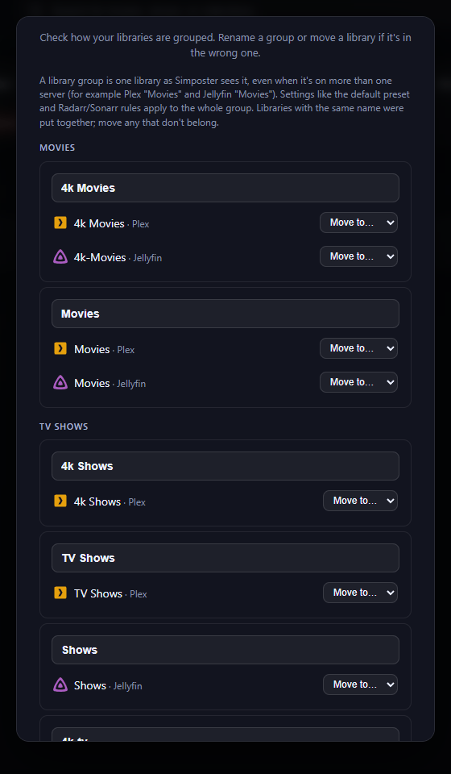

Libraries with the same name on different servers are put in one **library group**: Simposter treats Plex "Movies" and Jellyfin "Movies" as one library, shows each title once, and can send a poster to both. Rename a group, or use **Move to...** to put a library in another group (for example Plex "4k Movies" and Jellyfin "4k-Movies"). Only shown when you have libraries to group. More in [Media Servers](MEDIA_SERVERS.md#library-groups).

### 5. API keys

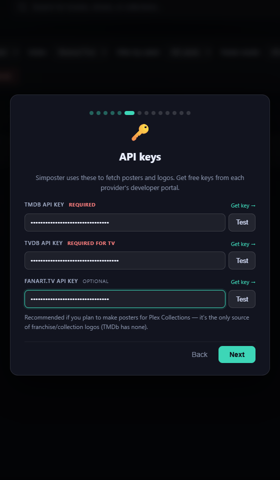

**TMDb** is required. **TVDB** is required if you picked a TV library. **Fanart.tv** is optional but is the only source of collection logos ([why](COLLECTIONS_AND_POSTERS.md#fanarttv-and-collections)). **Test** checks each key. Clicking Next imports the starter presets.

### 6. Your poster look

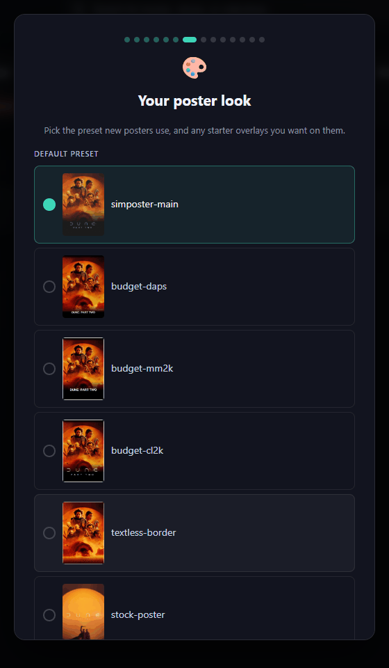

Pick the **default preset** new posters use (each is shown on a sample poster), and tick any **starter overlays** you want on them (resolution/audio badges, audience rating...). You can change both later.

### 7. Radarr & Sonarr (optional)

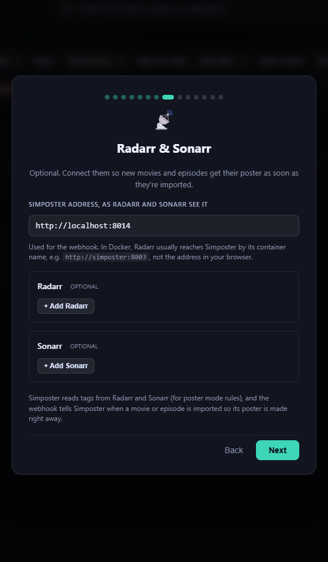

Add Radarr and/or Sonarr and click **Set up webhook**: Simposter creates its webhook in Radarr/Sonarr (on import and upgrade), so new movies and episodes get their poster as soon as they arrive. Enter Simposter's address *as Radarr sees it*: in Docker that's usually the container name, e.g. `http://simposter:8003`. Simposter also reads their tags for poster mode rules. More in [Webhooks](WEBHOOKS.md).

### 8. Group settings (optional)

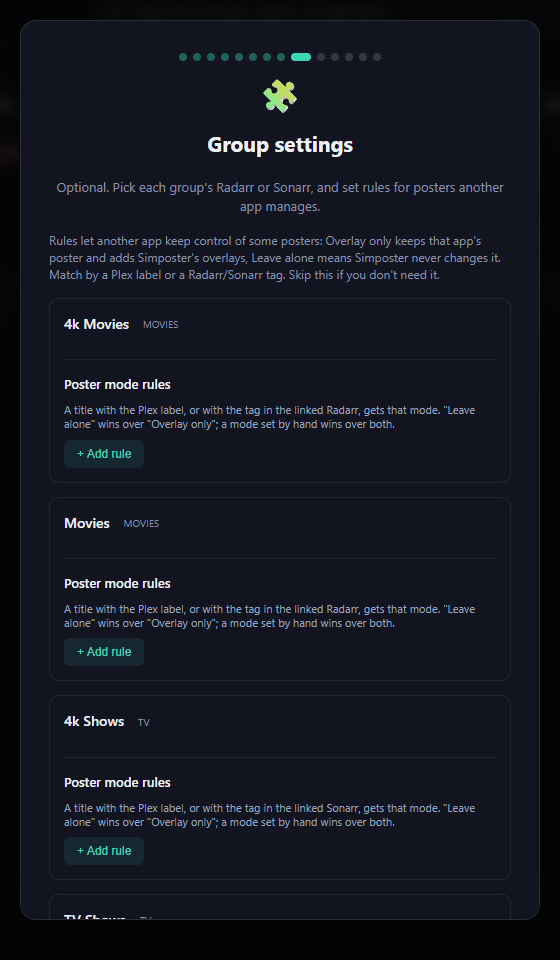

For each library group, pick its Radarr or Sonarr and add **poster mode rules**: titles with a certain Plex label or Radarr/Sonarr tag get "Overlay only" (keep another app's poster, add your overlays) or "Leave alone". Skip this if no other app manages your posters. See [Posters from another app](OVERLAYS.md#posters-from-another-app).

### 9. Extras (optional)

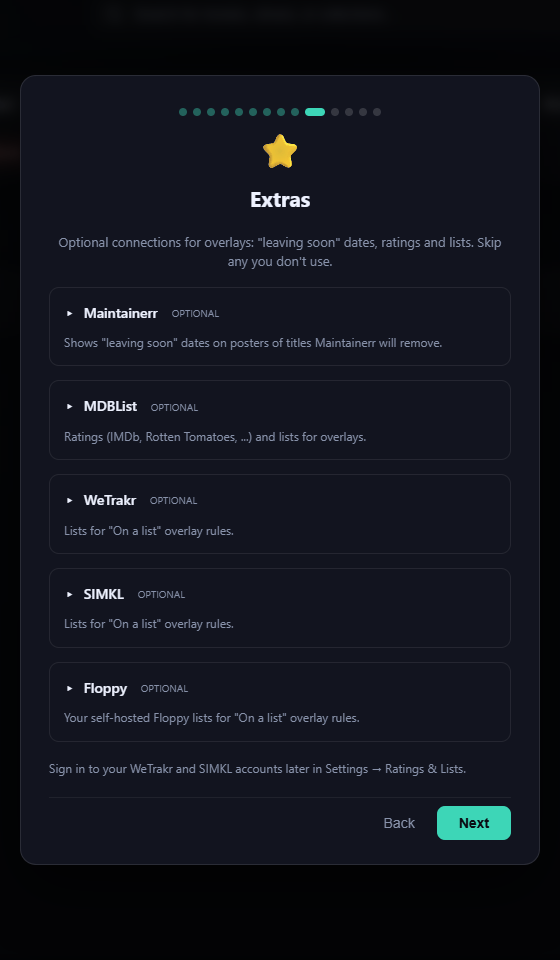

Connections for overlays: **Maintainerr** ("leaving soon" dates), **MDBList** (ratings from IMDb, Rotten Tomatoes and more, plus lists), and **WeTrakr**, **SIMKL** and **Floppy** lists. Skip any you don't use; they're all in Settings → Ratings & Lists later.

### 10. Automation

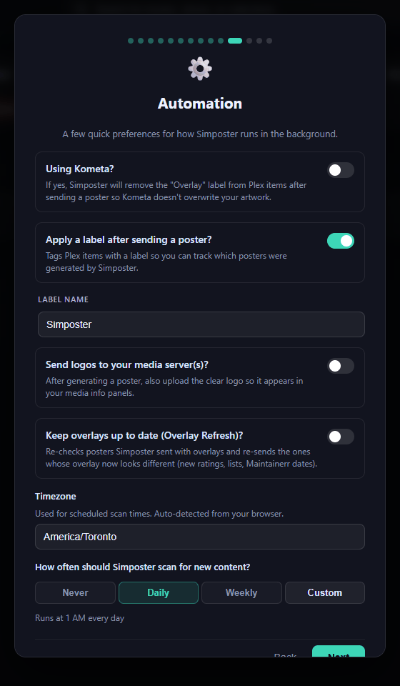

- **Using Kometa?** (Plex) removes Kometa's "Overlay" label when Simposter sends a poster, so Kometa doesn't replace it.
- **Apply a label after sending** (Plex) tags items Simposter made a poster for.
- **Send logos** to your servers along with posters.
- **Keep overlays up to date** turns on a daily [Overlay Refresh](OVERLAYS.md#overlay-refresh).
- **Timezone** and **how often to scan** for new content.

### 11. Performance

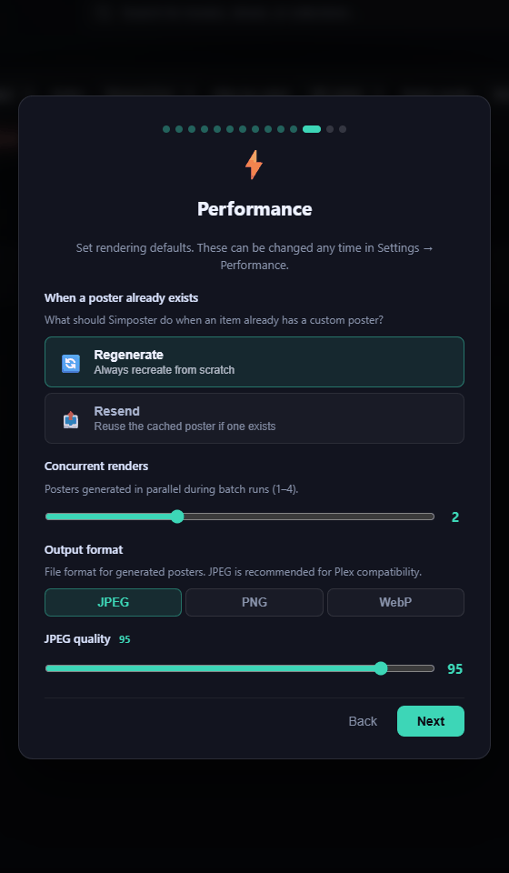

What to do when an item already has a Simposter poster (**Regenerate** or **Resend** the saved one), how many posters to render at once, and the file format for posters saved to disk.

### 12. Notifications and finish

Optionally turn on notifications to be told when posters are made. The wizard uses Apprise URLs (Discord, Slack, Telegram, email and 70+ more); Settings → Notifications also has a plain Discord webhook option. The last page shows what was set up and starts a scan of your libraries in the background.

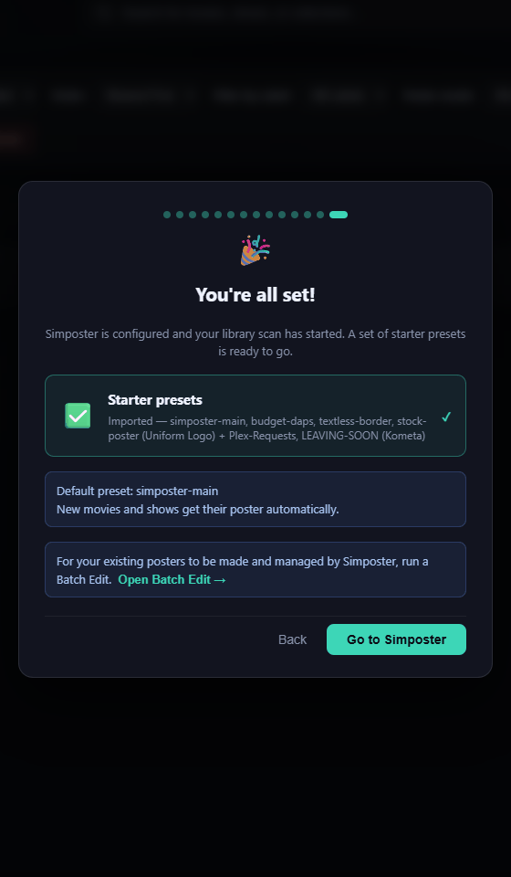

For posters on titles you already have, run [Batch Edit](USER_GUIDE.md#batch-edit) once the scan is done. If you skipped the wizard or deleted a starter preset, Template Manager → Import / Export → **Import Simposter defaults** brings them back.

---

## Your First Poster

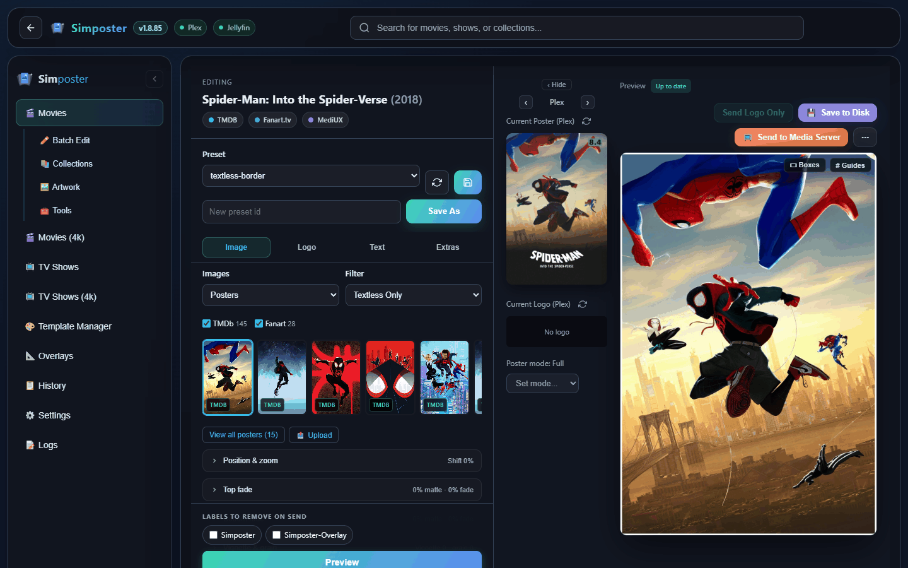

1. Open a library in the sidebar and click a title.
2. Pick a preset at the top of the editor.
3. Change the background (**Image** tab), logo (**Logo** tab), text or overlays if you like. The preview on the right updates after each change.
4. Click **Send to Media Server** (pick the servers if the title is on more than one) and/or **Save to Disk**.

The [User Guide](USER_GUIDE.md) explains every part of the editor and the other pages, with step-by-step guides for batch runs, automatic posters and overlays.

---

## Settings Reference

| Tab | What's in it |
|-----|--------------|
| **General** | Theme, poster display density, deduplication, default sort, TMDb/TVDB/Fanart API keys |
| **Ratings & Lists** | Where overlay audience/critic ratings come from (your media server, TMDb or MDBList), the MDBList key, WeTrakr, SIMKL and Floppy lists, and Maintainerr (see [OVERLAYS.md](OVERLAYS.md#ratings)) |
| **Libraries** | **Library groups** (link the same library across Plex/Jellyfin/Emby — see [MEDIA_SERVERS.md](MEDIA_SERVERS.md)), each shown as a one-line summary; **Edit** opens its auto-generate preset, Merge items, poster mode rules (Leave alone / Overlay only from Plex labels or Radarr/Sonarr tags) and the Plex labels to remove when sending; **Kometa compatibility** (always removes the "Overlay" label for every Plex library), add/remove libraries (removing purges that library's cache/DB rows, keeping History) |
| **Media Servers** | Add, name, test and remove Plex, Jellyfin and Emby servers (removing one purges its cached data on save); Radarr and Sonarr (tags for poster mode rules); turn the [Poster API](POSTER_API.md) on or off |
| **Output** | Save-location path templates (with Kometa-compatible presets, including a `{folder}` variable that matches Radarr/Sonarr's real on-disk folder names) for movies, TV shows, and collections; batch subfolder option; image format/quality |
| **Automation** | **Logos** (send logos with posters by default), **Webhooks** (auto-send to your media servers, season posters, webhook secret) and the webhook URL generator; **Items that already have a poster** (regenerate or resend, and **Reuse Cached Poster For (days)**, which protects a hand-tuned poster when Radarr/Sonarr or a similar tool makes the server re-match an item under a new ID); the **Retry queue**; **Plex labels** (an optional label added after a poster is sent) |
| **Performance** | Concurrent renders (up to 10 — see the tip below), overlay cache, API rate limits, cache management |
| **Notifications** | Discord webhook and Apprise URLs, per-event toggles (batch / manual / webhook / auto-generate / Media Mirror / Overlay Refresh / app updates), which library groups to notify for |
| **Advanced** | **Run Startup Wizard** button, API source priority order, database backup/restore |
| **Cleanup** | Find and clear Simposter's own stale cache (reversible), compact Simposter's database, scheduled cleanup, and **Media Server Maintenance** for each of your servers |

| Output | Notifications |
|---|---|
| 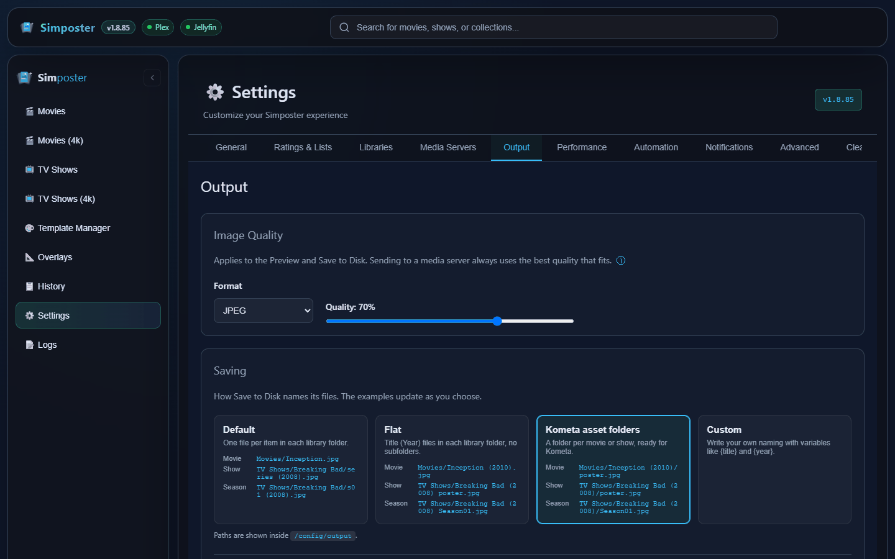 | 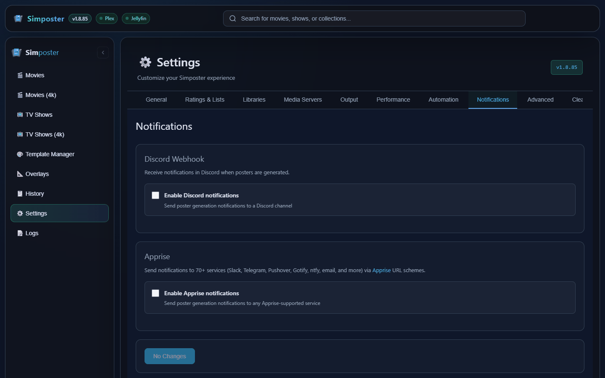 |

> **Tip:** if batch renders feel slow, try raising **Concurrent Rendering** in Performance — it's not capped at a low number the way some tools are. Going from 2 to ~8-9 workers has been measured cutting total batch time by more than half on real libraries, at the cost of each individual item taking a bit longer (worth it for the total time saved). Overlay cache should also stay on; it's the single biggest speed lever for the Uniform Logo template.

---

## Fonts

- **Starter fonts**: importing the Simposter defaults (in the setup wizard, or Template Manager → **Import Simposter defaults**) also downloads a set of free fonts: Arimo, Roboto, Inter, Montserrat, Lato, Comfortaa and Bebas Neue. Fonts used by any presets you import are downloaded too.
- **More free fonts**: Simposter can also download any font from its own font collection (24 open-licensed families such as Poppins, Oswald and Playfair Display) the first time a preset or overlay asks for it, so shared presets render the same on another install.
- **Arial and Helvetica** aren't free to ship, and the Docker image doesn't have them. When a preset asks for one and it isn't installed, Simposter uses Arimo, a free font with the same shape and spacing as Arial.
- **Your own fonts**: put `.ttf`/`.otf` files in `config/fonts` and use the file name (without extension) as the font name. They take priority over everything else, so you can use a font you own, like Helvetica.

---

## Environment Variables

**None of these are required.** Everything below — Plex connection, API keys, library names — can be set (and changed later) through the setup wizard or the Settings UI instead, with no env vars or config file editing at all. Setting them as env vars is purely a convenience for pre-filling values (e.g. scripted/repeatable Docker deployments) so you don't have to re-enter them through the UI.

| Variable | What it pre-fills | Example |
|----------|--------------------|---------|
| `PLEX_URL` | Plex server URL | `http://plex:32400` |
| `PLEX_TOKEN` | Plex auth token | `xxxyyyzzz` |
| `PLEX_MOVIE_LIBRARY_NAME` | Movie library name | `Movies` |
| `TMDB_API_KEY` | TMDb API key | `abcd1234` |
| `TVDB_API_KEY` | TVDB API key | `efgh5678` |
| `FANART_API_KEY` | Fanart.tv API key | `ijkl9012` |
| `JELLYFIN_URL` | Adds a Jellyfin server to Settings → Media Servers (with `JELLYFIN_API_KEY`) | `http://jellyfin:8096` |
| `JELLYFIN_API_KEY` | API key for that Jellyfin server | `0123abcd` |
| `DISABLE_UPDATE_CHECK` | Set to `1` to stop Simposter checking GitHub for a newer version of your branch | `1` |
| `CONFIG_DIR` | Config directory path (Docker default: `/config`) | `/config` |

For Docker, set these under `environment:` in `docker-compose.yml`. For local dev, put them in a `.env` file at the repo root (see [`.env.example`](../.env.example)). Env vars only seed a **fresh, unconfigured** database on first startup — once you've set something through the wizard or Settings, that saved value takes priority from then on, so changing/removing an env var later won't silently override what you've already configured in the UI. If you remove Plex in Settings → Media Servers, `PLEX_URL`/`PLEX_TOKEN` are ignored from then on, so Plex doesn't come back on the next restart. `JELLYFIN_URL`/`JELLYFIN_API_KEY` add the server once; after that it's managed in Settings → Media Servers (a server you remove there isn't added back, and a different `JELLYFIN_URL` adds that server). Emby servers are set up in the UI only. `TVDB_API_KEY`/`FANART_API_KEY` are used until a key is saved in Settings → General.

---

## File Layout

```
config/
├── settings/
│   └── simposter.db       # SQLite — settings, presets, history, cache
├── logs/
│   └── simposter.log      # Application logs
├── cache/
│   └── poster_renders/    # Cached rendered posters for resend mode
├── overlays/              # Pre-rendered effect layers (matte/fade/vignette), rebuilt automatically
├── assets/                # Overlay images (uploaded or imported from Kometa files)
├── fonts/                 # Your own fonts, and fonts added with Kometa imports
├── fonts_cache/           # Fonts Simposter downloaded (starter fonts, Kometa's fonts)
└── output/                # Saved poster files
    └── {Library}/
        └── {Title} ({Year}).jpg
```

Legacy `presets.json` and `ui_settings.json` migrate automatically to SQLite on first run. A database backup is created automatically on version upgrades.
