# User Guide

A page-by-page tour of Simposter, followed by step-by-step guides for the things most people set up first. If you haven't installed it yet, start with [Getting Started](GETTING_STARTED.md).

- [The layout](#the-layout)
- [Library grid](#library-grid)
- [The poster editor](#the-poster-editor)
- [TV shows and seasons](#tv-shows-and-seasons)
- [Batch Edit](#batch-edit)
- [Collections](#collections)
- [Artwork: logos, backdrops, square art, thumb art](#artwork-logos-backdrops-square-art-thumb-art)
- [Tools: Overlay Refresh, Media Mirror, Poster Import, Local Assets, Backup](#tools-overlay-refresh-media-mirror-poster-import-local-assets-backup)
- [Template Manager](#template-manager)
- [Overlays](#overlays)
- [History](#history)
- [Settings](#settings)
- [Poster API](#poster-api)
- [Logs](#logs)
- [How-to guides](#how-to-guides)

---

## The layout

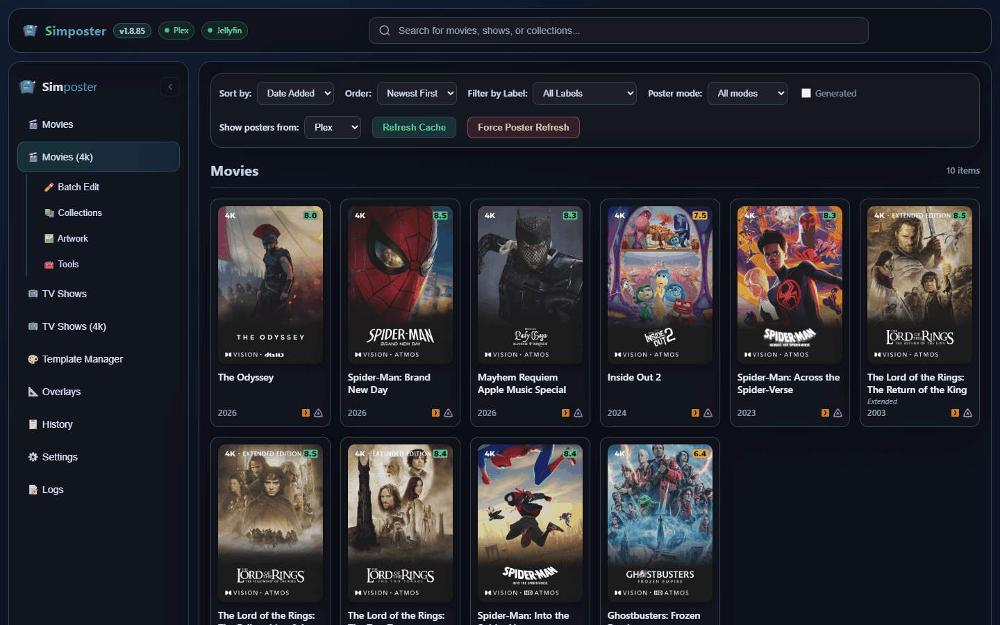

- **Top bar**: the version, a status pill for each media server (green = reachable), and a search box that finds any movie, show or collection. Picking a search result asks what you want to edit: poster, logo, backdrop or square art.
- **Sidebar**: one entry per library group (for example "Movies" and "Movies (4k)"). Open one to see its sub-pages: **Batch Edit**, **Collections** (movies only), **Artwork** and **Tools**. Below the libraries are Template Manager, Overlays, History, Settings and Logs.

A *library group* is one library as Simposter sees it, even when it's on more than one server (Plex "Movies" plus Jellyfin "Movies"). See [Media Servers](MEDIA_SERVERS.md#library-groups).

---

## Library grid

Every library group opens on a grid of its posters (the screenshot above).

- **Sort / Order / Filter by Label / Poster mode**: narrow down what's shown. "Generated" shows only titles Simposter has made a poster for.
- **Show posters from**: when a title is on more than one server, which server's poster the card shows.
- **Refresh Cache** re-reads the library from Simposter's cache; **Force Poster Refresh** downloads every poster from the server again.
- The small icons under each card show which servers have the title (Plex, Jellyfin, Emby, Silo). A **Changed** badge means the poster was changed on the server after Simposter sent it (see [History](#history)).
- Cards Simposter has made a poster for have a resend arrow: it sends that poster again, without rendering, to the servers you pick.
- Click a card to open the editor.

---

## The poster editor

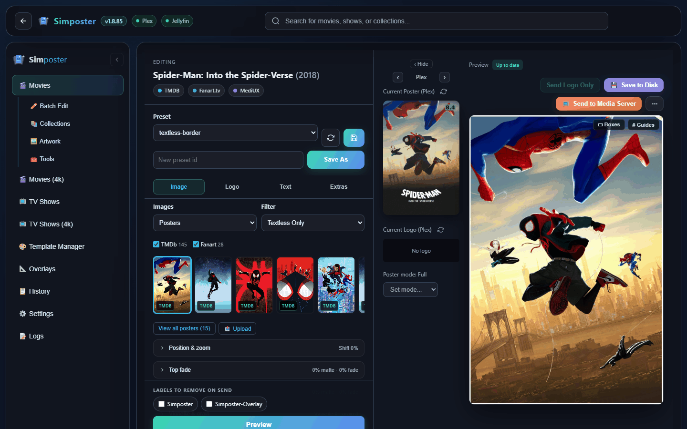

The editor has three columns.

**Left: settings.** At the top is the **preset** (a saved set of settings) with buttons to reload it, save your changes into it, or **Save As** a new preset. Below are four tabs:

| Tab | What's in it |
|-----|--------------|
| **Image** | Posters or backdrops as the background, a text filter (textless only, with text, any), which sources to use (TMDb, Fanart.tv, TVDB), the thumbnails to choose from, **View all**, and **Upload** (a file or a link). Cards below set position and zoom, top fade, bottom fade, vignette and grain. |
| **Logo** | Logo mode (none, first available, white, color...), style, source, the logo to use, the logo box (size and position), and a drop shadow. |
| **Text** | Custom text, such as `{title}` or `{season}`, with font, size, color, alignment, shadow and outline. The text sits in its own box. |
| **Extras** | Border and the overlays to draw on this poster. |

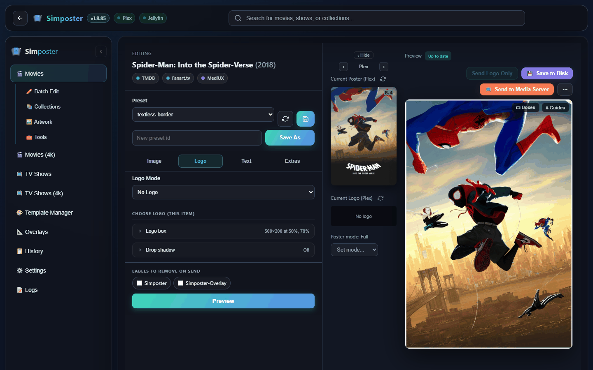

At the bottom: **Labels to remove on send** (Plex only, e.g. Kometa's "Overlay" label) and **Preview**. The preview also updates by itself a moment after you change something.

**Middle: what's on the server now.** The current poster and logo, with ‹ › to switch between servers when the title is on more than one. **Poster mode** sets how Simposter treats this title: Full (the default), Overlay only (keep another app's poster and only add your overlays) or Leave alone. See [Posters from another app](OVERLAYS.md#posters-from-another-app). The column can be hidden with **‹ Hide**.

**Right: the preview.** The status shows *Rendering...*, *Not up to date* or *Up to date*. **Boxes** draws the logo box (yellow) and text box (blue) on the preview; drag a box to move it or its corner to resize it. **Guides** shows centre lines and a safe area.

Buttons above the preview:
- **Send to Media Server**: renders and uploads the poster. If the title is on more than one server, you pick which ones get it.
- **Save to Disk**: writes the poster to your output folder (Settings → Output).
- **Send Logo Only**: uploads just the logo.
- **⋯**: add the title to the retry queue (try again later, for example when a textless poster appears on TMDb).

Changes you make here are only used for this poster until you save them into a preset.

---

## TV shows and seasons

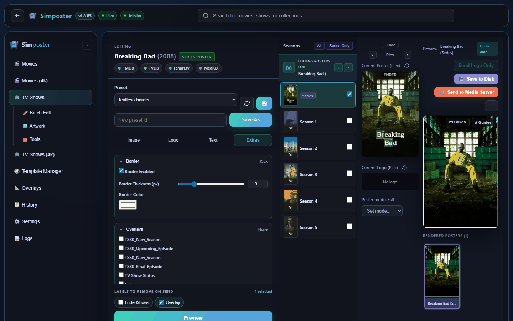

TV shows have one more column: **Seasons**. The series poster and each season poster have their own settings and their own preview.

- Click a season (or the series) to edit it. ‹ › next to "Editing posters for" step through them.
- Tick seasons to include them when you save or send. **All** selects every season, **Series only** just the series poster.
- **Rendered Posters** under the preview shows every poster already rendered in this session.
- A preset can store different settings for seasons (for example no logo, and the text `{season}` instead). Save Preset while a season is open saves the season settings.

---

## Batch Edit

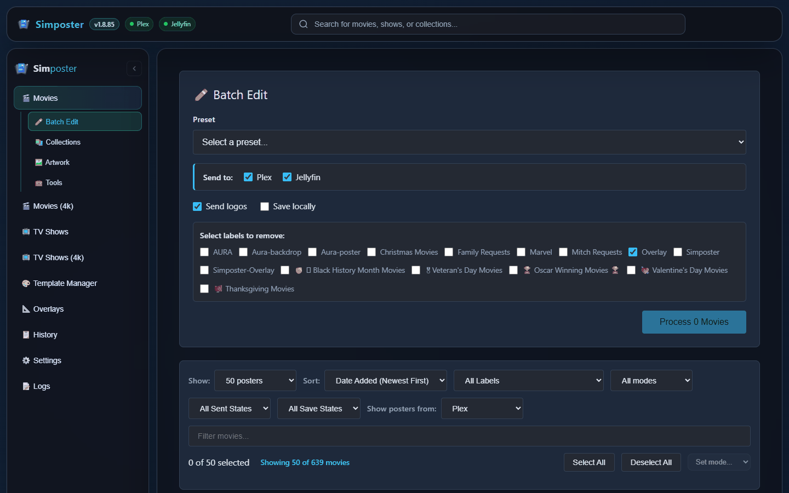

Batch Edit applies a preset to many titles at once.

1. Pick a **Preset**.
2. Choose where the posters go: **Send to** each of the group's servers, **Send logos**, and/or **Save locally**.
3. Tick the Plex labels to remove when sending.
4. Select titles in the grid below. Filters help: sort, label, poster mode, "sent" and "saved" state, and a search box. **Select All** selects every title the filters show.
5. Click **Process**. A progress pop-up shows each title as it's done, and the results list what was sent, skipped or failed.

Titles set to **Leave alone** are skipped unless you tick "Include Leave alone titles". **Set mode...** changes the poster mode of every selected title.

TV Batch Edit also has an **Include seasons** option.

---

## Collections

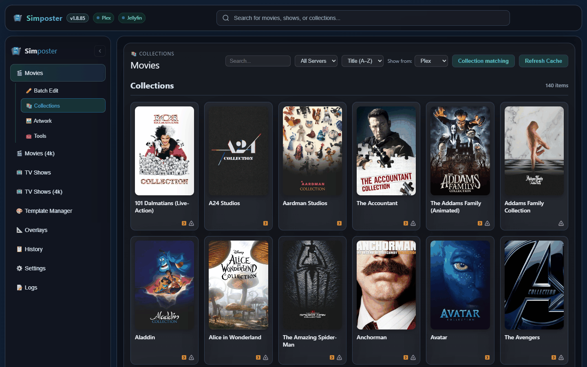

Plex, Jellyfin and Emby collections (movie library groups only). Click one to choose an editor:

- **Simposter Creator**: the normal poster editor.
- **Kometa Creator**: Kometa-style collection posters: a background color or texture, a centered logo and text.

Collection logos come from Fanart.tv, so a Fanart.tv key matters here ([why](COLLECTIONS_AND_POSTERS.md#fanarttv-and-collections)). **Collection matching** links collections with different names on different servers ([details](MEDIA_SERVERS.md#collections-across-servers)).

---

## Artwork: logos, backdrops, square art, thumb art

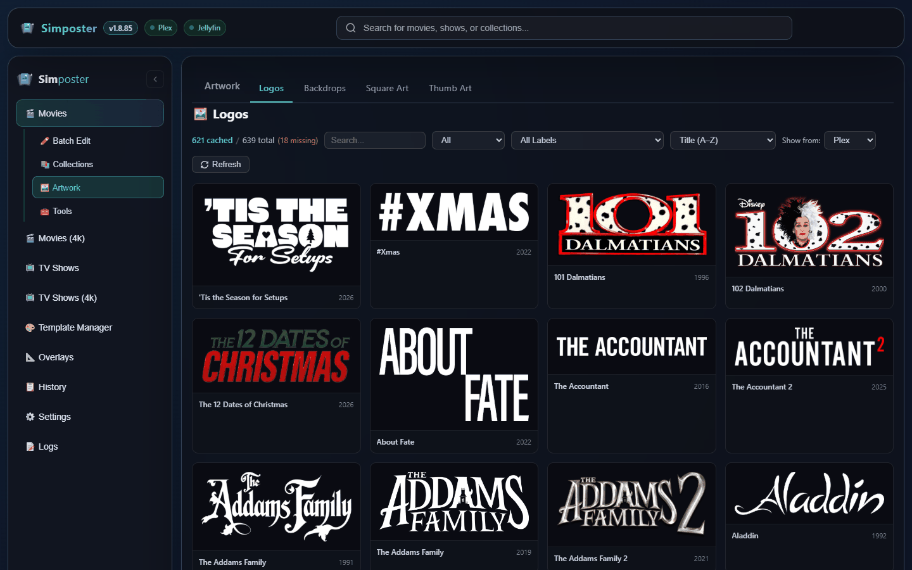

The **Artwork** page of each library group has a tab per artwork type. Each shows what's on the server now, with a count of how many titles have one and how many are missing.

- **Logos**: clear logos (the transparent title graphic).
- **Backdrops**: the background art behind the poster in Plex/Jellyfin.
- **Square Art**: Plex only.
- **Thumb Art**: Jellyfin/Emby only (the 16:9 "Thumb" image).

Click a tile to choose a new one from TMDb/Fanart.tv (or make one from a preset, for square and thumb art) and send it. If the title is on several servers you pick which ones get it.

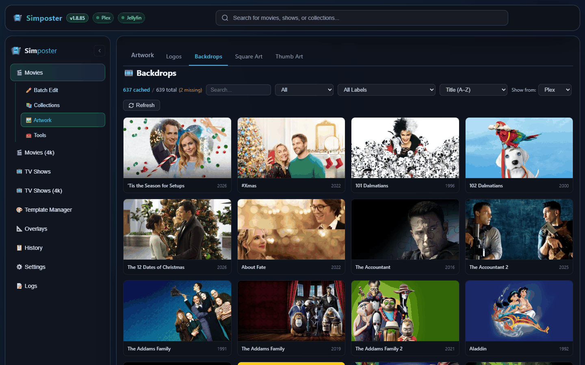

---

## Tools: Overlay Refresh, Media Mirror, Poster Import, Local Assets, Backup

The **Tools** page of each library group has these tabs.

**Overlay Refresh** re-renders posters whose overlay would now look different, for example when a rating changed, a movie was upgraded to 4K or a title joined a list. **Check for changes** lists them without sending anything; **Refresh changed posters** sends them. Turn on **Refresh on a schedule** to do it automatically. See [Overlay Refresh](OVERLAYS.md#overlay-refresh).

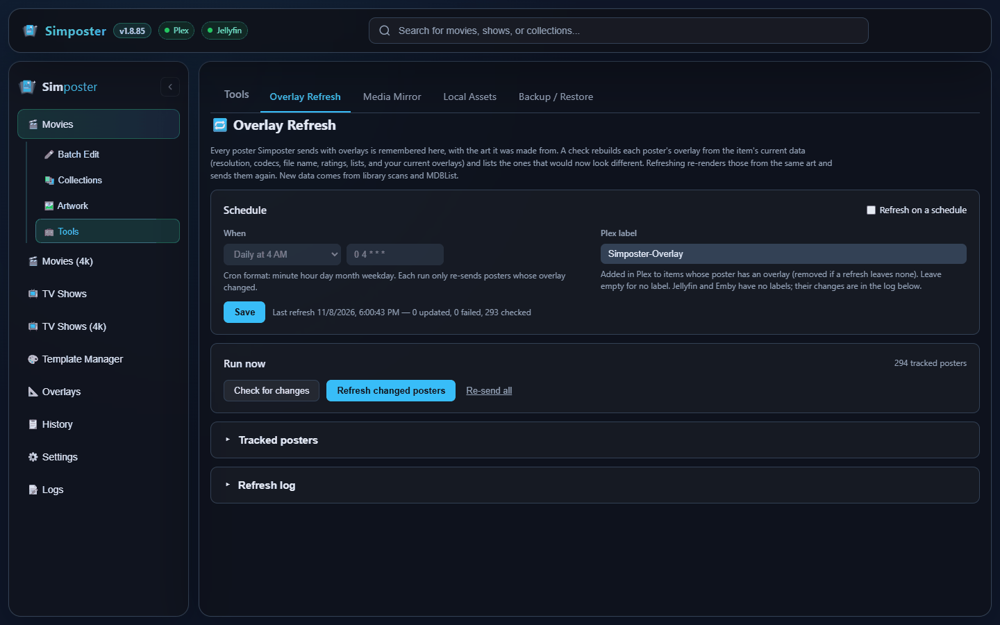

**Media Mirror** copies artwork from one server to the others in the group (for example Plex → Jellyfin), once or on a schedule. The table below confirms which title on each server matches. See [Media Mirror](MEDIA_SERVERS.md#media-mirror).

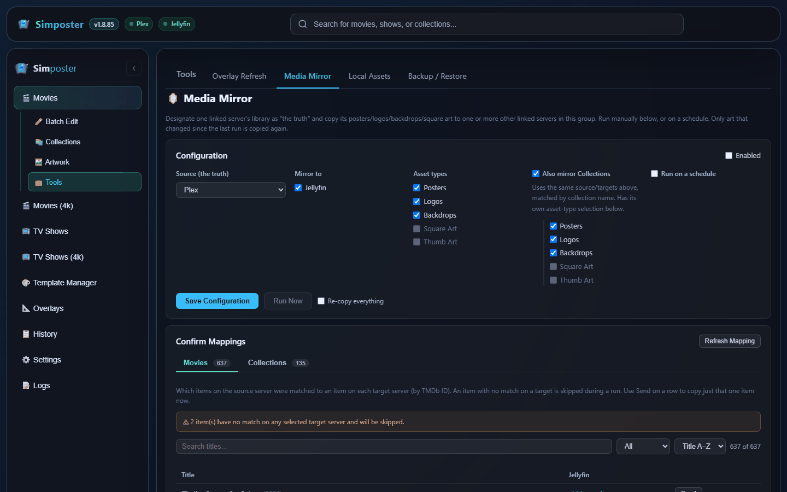

**Poster Import** applies posters you've picked elsewhere, from a Kometa-style file with `url_poster` links: a Kometa metadata file (titles keyed by TMDb id, shows by TVDB id) or TPDbCollectionMaker's output (titles, seasons and collections). Paste or load the file, press **Check** to see which titles were found in this library group, then **Import**. Choose what happens to each poster:

- **Render with a preset**: the poster becomes the background of a normal Simposter render (logo, text, effects, overlays).
- **Overlays only**: the title is set to Overlay only and the preset's overlays are drawn on the poster.
- **Use as-is and leave alone**: the poster is uploaded unchanged and the title is set to Leave alone.

Collections are always uploaded as-is. Each linked image is downloaded once and kept, and stays that title's poster: later renders and Overlay Refresh keep using it (the **Imported posters** tab lists them and can remove one). Under **Live files** you can point at a file on the Simposter server, such as one of your Kometa metadata files, or at a link to a file someone shares (a GitHub file or Kometa's `git:` shorthand). It's read again on a schedule and titles that are new or whose link changed are imported. Tick **Ask before applying** to see the new or changed titles first and import them with **Apply**; that's recommended for a file someone else edits.

**Local Assets** lists the posters saved to your output folder, with resend, rename and delete.

**Backup / Restore** downloads the artwork currently on your server (posters, logos, backdrops, square/thumb art) to a folder, so you can put it back later, for example before trying a new preset on your whole library. This is different from the database backup in Settings → Advanced, which saves Simposter's own settings and presets.

---

## Template Manager

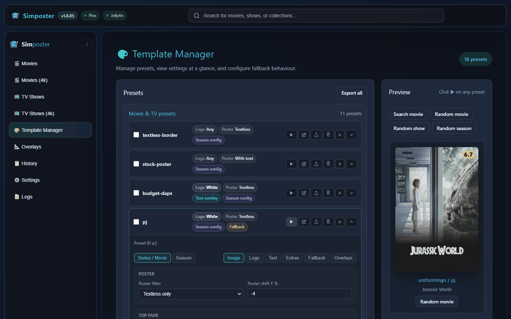

All your presets in one list.

- **▶** previews a preset on the right, on a random movie, show or season, or one you search for.
- **⌄** opens the preset to edit its values by typing, without the poster editor: Series/Movie and Season settings, with tabs for Image, Logo, Text, Extras, Fallback and Overlays. The **Overlays** tab sets which overlays the preset draws and in what order.
- **Fallback** decides what happens when a title has no logo or no matching poster: keep going, or switch to another preset.
- The other buttons rename, share as a file (presets with their overlays, images and fonts), duplicate and delete.
- **Import / Export** at the bottom: **Import Simposter defaults** brings back the starter presets, and you can import a shared preset file or export your own.

When you change which overlays a preset uses, Simposter offers to refresh the posters already sent with it.

---

## Overlays

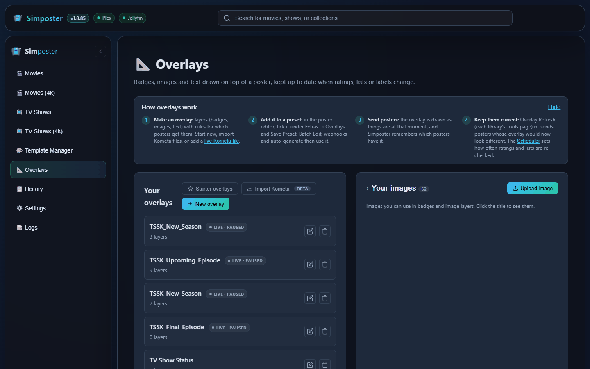

Overlays are badges, images and text drawn on top of the poster: 4K, Dolby Vision, the rating, a "NEW SEASON" ribbon. The page starts with a short "How overlays work" guide.

- **Starter overlays**: ready-made overlays (resolution/audio badges, audience rating, Maintainerr "leaving soon"). One click adds them with their images.
- **Import Kometa** (beta): bring in your Kometa overlay files.
- **New overlay**: build your own.
- **Your images**: images for badges and image layers.

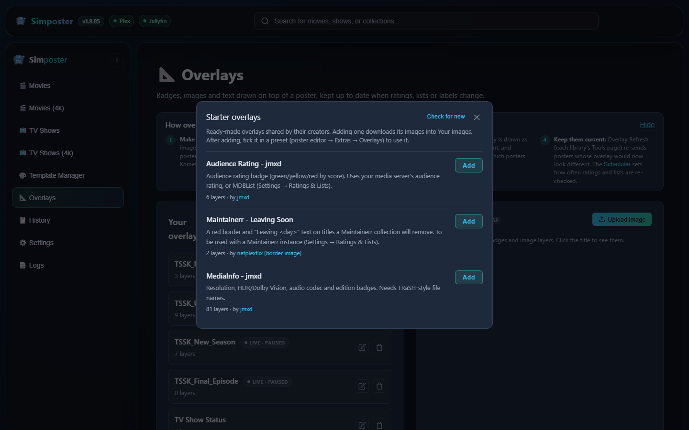

The overlay editor has the list of layers on the left and a live preview on the right. Preview it with example values, or on a real movie or show from your library.

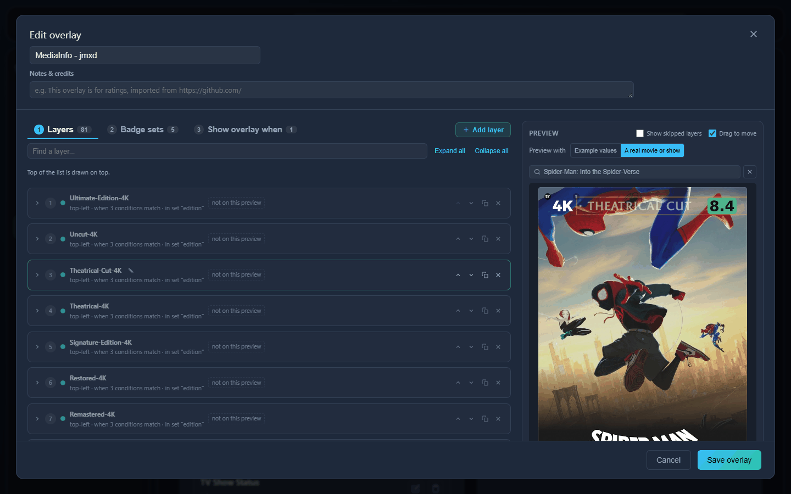

An overlay does nothing until it's added to a preset: tick it in the poster editor (Extras → Overlays) or in Template Manager, then save the preset. The full guide is [Overlays](OVERLAYS.md).

---

## History

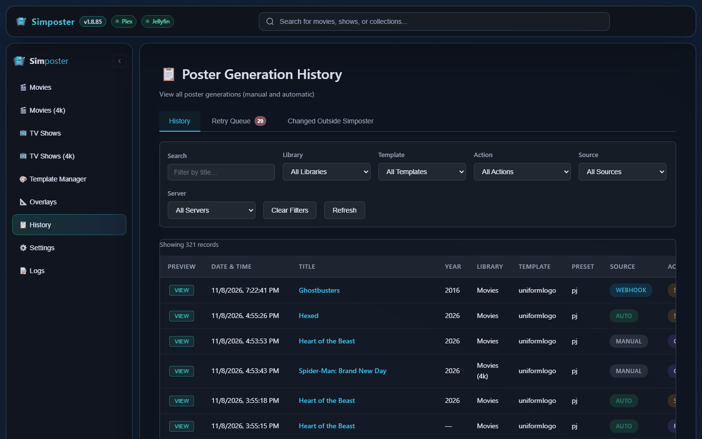

Every poster Simposter made or sent: when, which library, template and preset, the source (Manual, Batch, Webhook, Auto) and what happened. Hover or click **View** to see the poster. Filter by title, library, template, action, source or server.

The **Retry Queue** tab lists titles waiting for better artwork, for example a textless poster or a logo that doesn't exist yet. They're tried again on a schedule and sent once the result matches your preset.

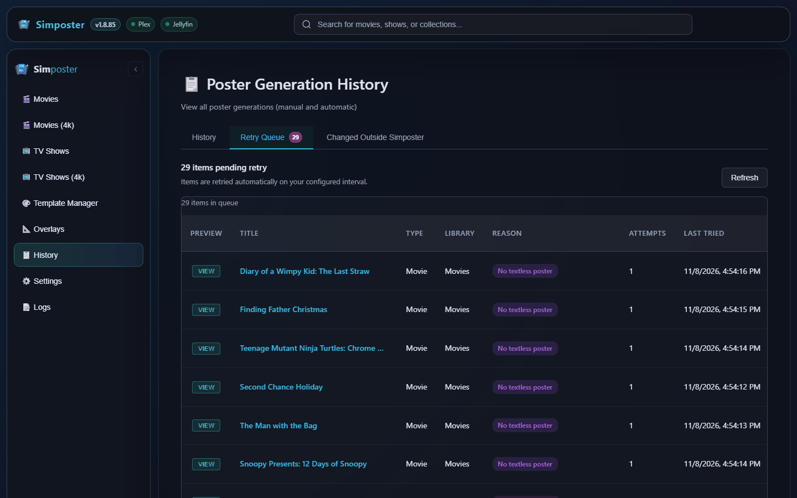

**Changed Outside Simposter** lists posters, logos and backdrops that were replaced on the server after Simposter sent them (by Kometa, another app or by hand). For each one you can put Simposter's back or keep the server's. You can also choose what happens automatically: list them, notify you, or put Simposter's back.

---

## Settings

| Tab | Use it to |
|-----|-----------|
| **General** | Theme, posters per page, timezone, TMDb/TVDB/Fanart.tv keys |
| **Ratings & Lists** | Where audience/critic ratings come from, and MDBList, WeTrakr, SIMKL, Floppy and Maintainerr |
| **Libraries** | Library groups: which libraries belong together, auto-generate preset, merge items, poster mode rules, labels to remove |
| **Media Servers** | Add and test Plex, Jellyfin, Emby, Radarr and Sonarr, and turn on the Poster API |
| **Output** | Where saved posters go and how they're named, image format and quality |
| **Performance** | Concurrent renders, overlay cache, API rate limits |
| **Automation** | Webhooks and the webhook URL generator, existing-poster handling, retry queue, Plex labels |
| **Notifications** | Discord and Apprise |
| **Advanced** | Run the setup wizard again, API source order, database backup and restore |
| **Cleanup** | Clear Simposter's old cache files, compact its database, and run each media server's own maintenance |

Settings only take effect when you click **Save Changes**. A section with unsaved changes is highlighted.

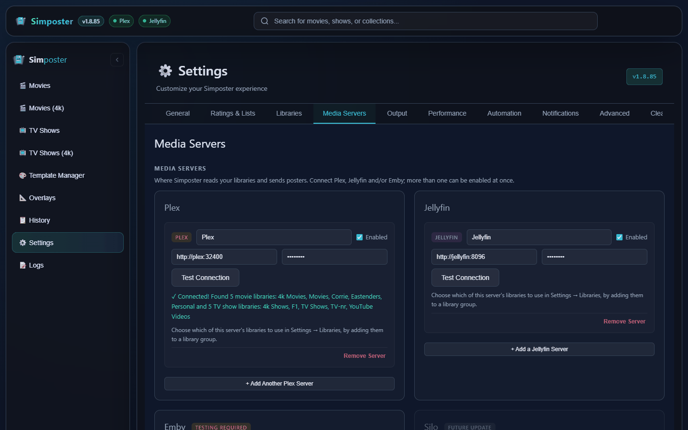

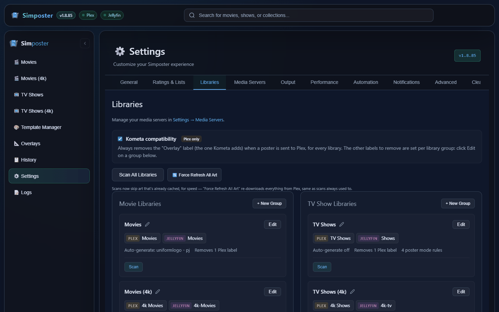

Click **Edit** on a library group to see all its settings:

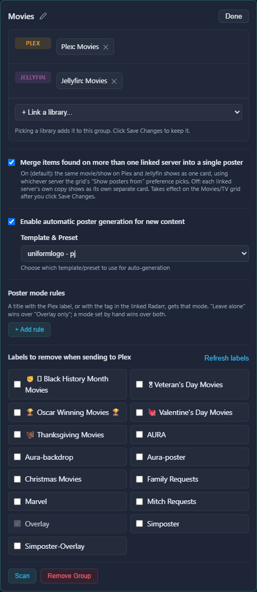

The full list of what each setting does is in [Getting Started → Settings reference](GETTING_STARTED.md#settings-reference).

---

## Poster API

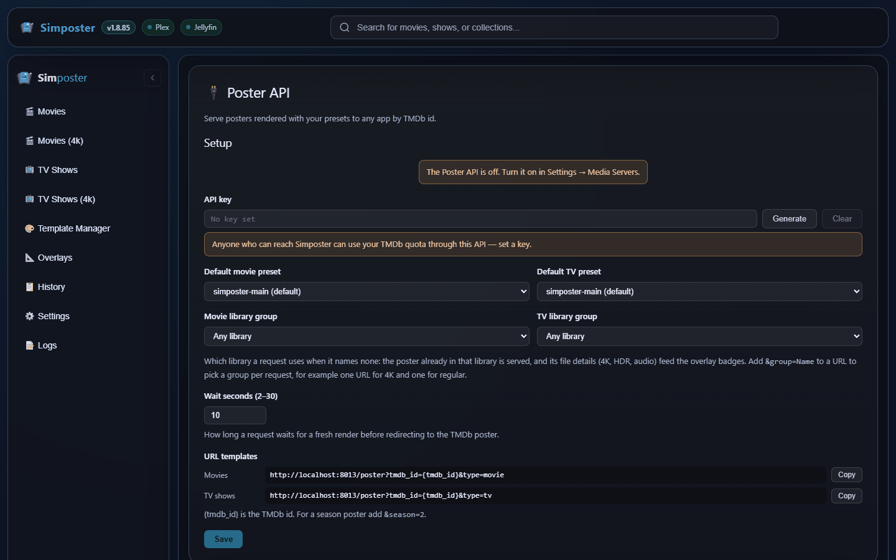

Other apps can request a poster by TMDb id and get the one you pinned, the one already in your library, or a fresh render with your preset. Turn it on in Settings → Media Servers, set a key, and copy the URL. See [Poster API](POSTER_API.md).

---

## Logs

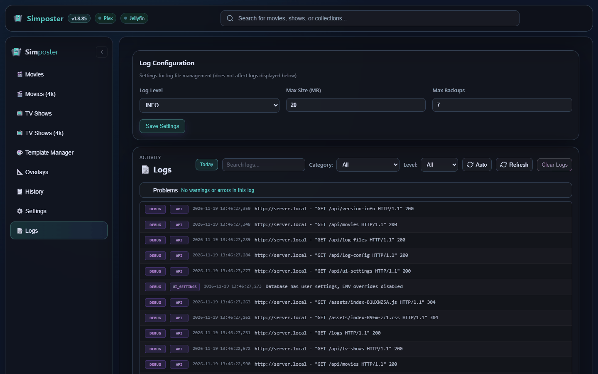

The application log, with filters for level and category. **Problems** at the top groups repeated warnings and errors from the whole day and explains what to do about common ones. Check here first when something didn't happen.

---

## How-to guides

### Make your first poster

1. Open a library in the sidebar and click a movie.
2. Pick a preset at the top of the editor (for example `simposter-main`).
3. In the **Image** tab, click a different thumbnail if you'd like another background. In the **Logo** tab, pick a logo.
4. Wait for the preview to say *Up to date*.
5. Click **Send to Media Server**.

To keep your changes for other titles, click the save icon next to the preset (changes the preset) or type a name and click **Save As** (new preset).

### Give the whole library the same look

1. Open **Batch Edit** for the library.
2. Pick the preset, tick your servers under **Send to**.
3. **Select All**, then **Process**.

Start with a few titles to check the result. Posters that couldn't get the artwork the preset wants (no textless poster, no logo) go to the [retry queue](#history) if retries are on.

### Get posters automatically for new movies and episodes

1. In **Settings → Libraries**, click **Edit** on a group and turn on **automatic poster generation** with a preset. Scans now make posters for new titles.
2. For posters the moment a file is imported, connect Radarr/Sonarr: the setup wizard can create the webhook for you, or copy the URL from **Settings → Automation → Webhook URL Generator**. See [Webhooks](WEBHOOKS.md).

### Add a 4K or rating badge

1. **Overlays → Starter overlays → Add** next to "MediaInfo - jmxd" (resolution and audio) or "Audience Rating - jmxd".
2. Open a poster in the editor, go to **Extras → Overlays**, tick the overlay and save the preset.
3. Send posters as usual. To update posters you already sent, use **Tools → Overlay Refresh**.

### Keep Plex and Jellyfin the same

Either:
- send to both: link the libraries in one group (Settings → Libraries) and tick both servers when you send, or
- copy one to the other: **Tools → Media Mirror**, source Plex, target Jellyfin, then **Run Now** or a schedule.

### Let another app own the poster

If Aura or another tool picks your posters, set those titles to **Overlay only** (Simposter just adds your overlays) or **Leave alone** (Simposter doesn't touch them). Set it per title in the editor or Batch Edit, or with rules on the library group: a Plex label or a Radarr/Sonarr tag. See [Posters from another app](OVERLAYS.md#posters-from-another-app).
